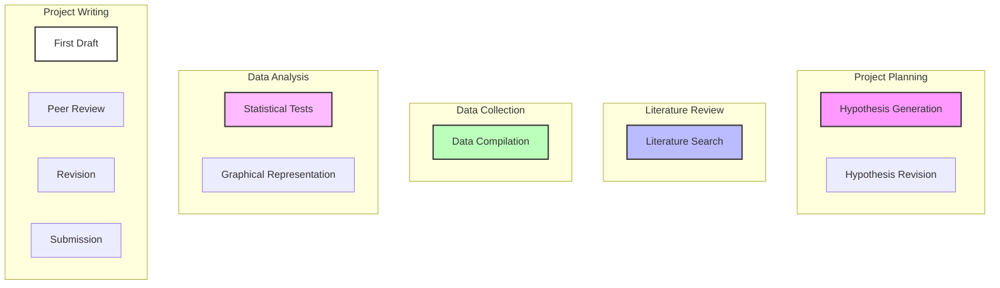
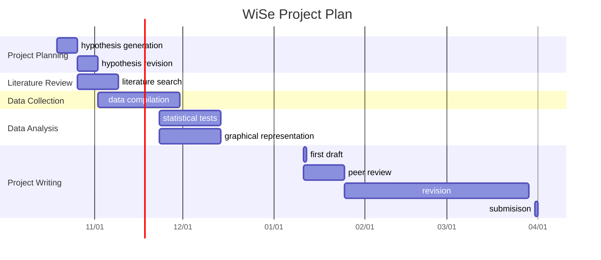
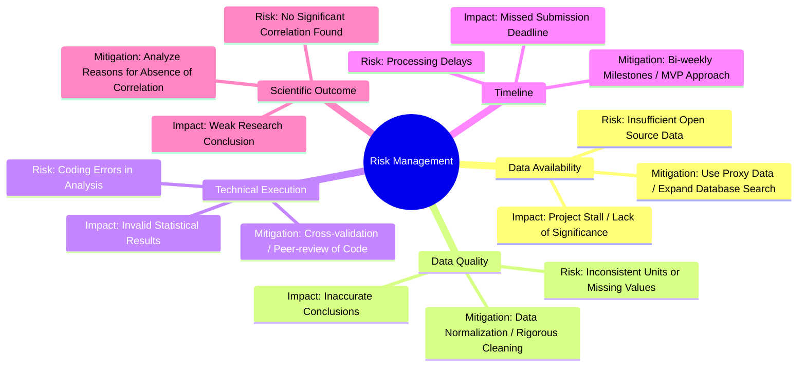
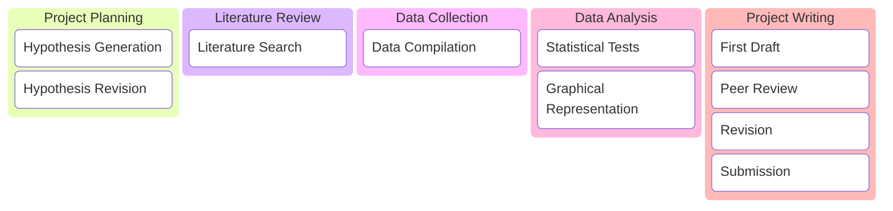

# Literature
October
## Literature Collection
##

# Data
November
## Notes
- all data are natural tidal waters
- grouping by river basin? then correlate latitude, soil depth, sequestration, organic carbon
- standardize size and tonnes of carbon
- create a prediction model based on correlations?
## Methodology
1. Linear Regression
2. Mixed-Effects Model

# Writing
December

# Review
January

# Finalization 
February

# Submission
March

Risk Management

Kanban

